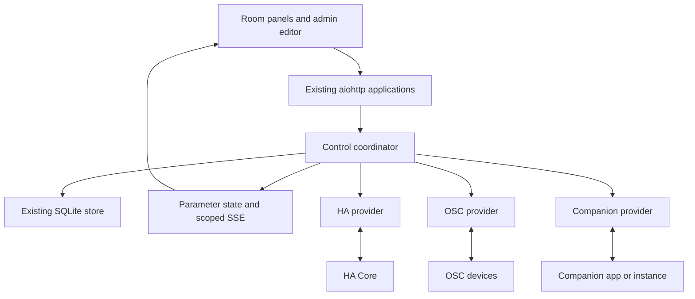

# Shared controls, device providers and fader policy

Proposed design for the Room Panel 0.1.2 baseline recorded in [research](01-research.md). All new modules, routes, fields and thresholds in this document are proposals. Existing code locations are listed in the implementation plan. Review these contracts before feature development.

## Responsibility boundaries

Retain the existing Python app, SQLite store, HA client and vanilla JS frontend. A small control coordinator resolves configured targets and applies authorization, mapping and scheduling. The HA provider wraps existing control.py functions. Native OSC and Companion providers implement the same small contract inside the process. Companion may run as another Supervisor-managed app on the same HA server or at a configured network address.



The coordinator has four operations, describe a target, read its latest state, execute an action, and set a numeric parameter. Lifecycle operations start and close each configured connection. Providers report state into the coordinator. Avoid a public plugin loader, message broker, expression language or separate device server for the initial milestone.

Configuration belongs in SQLite. Rapid device state, gesture ownership, pending commands and freshness live in bounded memory. Persisted diagnostic last values never become startup commands. HA entities remain owned by HA, while direct OSC state is owned by its connection. Representing the same parameter through OSC and Companion simultaneously needs an explicit single write-owner selection and a warning in the editor.

## Proposed data model

| Object | Required content |
| --- | --- |
| Connection | id, revision, name, kind ha/osc/companion, optional area_id, enabled, host, send port, local socket ID, feedback mode, timeouts, read-on-connect policy, profile ID/version, secret reference |
| Product profile | schema_version, stable profile ID, profile revision, manufacturer/model, transport capability, parameters/actions, exact argument schemas, device-domain units/ranges, wire conversions, queries, renewals and status evidence |
| Parameter | Stable connection-local ID, kind number/switch/select/sensor, readability/writability, canonical unit, representable domain, resolution, conversion and feedback binding |
| Action | Stable ID, permitted trigger behavior, fixed argument template and optional typed input fields. Scene recall is explicitly potentially multi-parameter. |
| Room control | Stable ID, room profile ID, target connection/parameter or action ID, label, control type, orientation, display range/unit/step, permitted output range, mapping curve, optional related mute action, visibility and appearance |
| Parameter policy | Canonical target ID plus installation-wide Room Panel bounds for that target. Every Room Panel route uses this policy. Per-room limits may narrow it. |
| Runtime state | observed value, commanded value, quality, availability, source, receive time, monotonic freshness deadline, sequence/revision, connection generation and pending command ID |

Room controls live in profile.controls and default to an empty list for old data. A panel retains profile_id and sections, with a new optional controls section. Different room profiles may give the same target different narrower ranges. Parameter policy is the common ceiling across Room Panel entry points. Administrative preview uses the same policy as normal operation.

For HA-generated cards, store optional overrides keyed by stable HA registry ID and parameter. Default generation retains current cards and layout. Applying the same override also to an explicit control for that target prevents a second unrestricted Room Panel volume slider.

An example proposed room control follows. Values are illustrative, with device-domain output in normalized amplitude.

```json
{
  "id": "foyer-level",
  "type": "fader",
  "label": "Foyer audio",
  "target": {"connection_id": "mixer-a", "parameter_id": "main.level"},
  "orientation": "vertical",
  "display": {"min": 0, "max": 100, "step": 1, "unit": "%", "show_value": true},
  "output": {"min": 0.0, "max": 0.7, "unit": "normalized_amplitude"},
  "mapping": {"kind": "linear"},
  "mute_action_id": "main.mute"
}
```

Connection secrets use write-only admin fields and public secret_set flags, following public_settings. SQLite and backups are sensitive storage. Do not claim database encryption without implementing key management. Product profiles contain declarative typed data. Vendor sessions needing code use a reviewed provider/profile handler shipped with the app. Generic OSC permits fixed addresses and validated numeric channel substitution, never Python/JS evaluation, shell commands or arbitrary executable profile hooks.

## Mapping and limits

For display endpoints d0 < d1 and device-domain endpoints o0 < o1, normalize user input as u = (d − d0)/(d1 − d0). Reject non-finite and out-of-display-range requests at the API. Linear output is o = o0 + u × (o1 − o0). The inverse is d = d0 + (o − o0)/(o1 − o0) × (d1 − d0).

| Display percent | Device output for 0–70% | Device output for 20–80% |
| --- | --- | --- |
| 0 | 0% | 20% |
| 25 | 17.5% | 35% |
| 50 | 35% | 50% |
| 75 | 52.5% | 65% |
| 100 | 70% | 80% |

The mapping pipeline is display normalization → monotonic control curve → canonical device value → effective policy intersection → product wire encoding → representable-value check. Intersect product bounds, target policy and room bounds in the same canonical unit. Reject empty intersections. Quantize to a representable value inside the intersection. If nearest rounding would exceed a maximum, choose the next allowed lower step. Reject intervals containing no representable value. Recheck policy revision immediately before sending, including commands already waiting in a queue.

Output limits are enforced by the server for direct commands, generic controls, legacy HA volume commands, admin test actions, Room Panel presets and automation requests. Frontend limits improve interaction only. Out-of-range network requests are rejected with a clear validation error. Rounding corrections happen within validated commands. Captured preset values that conflict with a newly reduced policy require review, so a recall cannot silently revive an old louder setting.

Room Panel can bound the writes it originates. A physical console, other apps, HA scenes/scripts or an opaque Companion macro can change the device independently. A scripted scene has no enforceable per-parameter guarantee unless the provider can enumerate and validate its writes. Mark such actions as external/opaque in administration, and omit them from controls advertised as constrained until reviewed. Absolute system-wide limiting requires the device/DSP's own policy.

### Preset values and partial execution

Extend the current capture/preview/save flow with an optional versioned parameter snapshot keyed by canonical target ID. Store canonical values, unit and profile revision, independently of a particular display range. Capture only fresh readable parameters. A write-only device can be excluded or explicitly captured as a last-commanded estimate, with that quality visible in the PIN review. The existing HA snapshot format remains readable and is translated at execution time.

Before any recall, resolve all targets and validate policy, device availability, profile versions and snapshot values. Reject a known incompatible preset before sending any command. Actual network/device failures can still produce partial execution after successful validation. Return per-target results and show partial completion. Do not perform an automatic audio rollback or retry an opaque macro. Restoring the previous saved preset restores stored data and still requires normal validation when activated. Configuration revision changes between preview and save invalidate the preview, using the existing conflict behavior.

### Audio and nonlinear conversion

Choose units explicitly. Normalized fader position, normalized amplitude and decibels are different domains. A profile defines the verified wire-to-canonical conversion. The room control defines the useful display range and taper. The frontend receives a display position and labels from the backend, without mixer formulas.

| Mode | Proposed behavior and validation |
| --- | --- |
| Linear | Exact affine mapping for percent, normalized numbers, lighting and native dB interpolation. |
| Logarithmic | Geometric interpolation between strictly positive amplitudes, a = a0 × (a1/a0)^u. Inverse uses logarithms. Zero is a separate defined silence endpoint. |
| Decibel | Linear interpolation in a configured finite dB interval. For amplitude conversion use a = 10^(dB/20), inverse 20 log10(a). A normalized wire value may instead require the manufacturer's fader law. |
| Manufacturer law | Reviewed monotonic piecewise conversion in a versioned profile with known endpoint and unity-gain fixtures. |
| Custom curve | Monotonic piecewise-linear control points with endpoints 0 and 1. Require strictly increasing input/output to obtain one inverse. Reject non-monotonic or flat segments in the first release. |

Silence is modeled as a separate sentinel with a product-specific wire encoding. Never serialize numeric infinity in JSON. Mute is a separate related action that can reach silence even when the fader's minimum is non-zero. Unmute must follow the product's documented behavior and must not restore a cached high level automatically. Decreasing numerical domains and non-invertible mappings are deferred until their semantics are defined.

External observed values outside a control range remain recorded as their real values. Clamp only the thumb's displayed position and show an out-of-range indicator. Do not send a corrective write when feedback arrives. For pickup interaction, require the operator to move the thumb to the clamped boundary before taking control, with a visible “Move to take control” state. The first bounded write after pickup is deliberate and may move an externally louder device down to the ceiling.

## State, gestures and synchronization

Keep four concepts separate in runtime data, last requested value, sent value, observed value and whether observation is fresh. Quality values include unknown, commanded, observed and stale. “Observed” means received through the provider. HA state updates and Companion variable updates are evidence at those layers, and do not universally prove a physical device acknowledgement. Connection availability is per provider/connection, not the global ha.connected flag.

An initial snapshot includes controls, capabilities, state, config_revision and stream_epoch. Each SSE state delta carries epoch, revision, canonical target ID, mapped display value, quality, availability and originating command ID when known. Filter it by the panel's authorized controls before serialization. Keep the existing refresh event for structural changes and old clients. On stream reconnect, page foregrounding, epoch mismatch or a gap, fetch an authorized fresh snapshot. Register the event stream before taking the snapshot and buffer deltas until that snapshot revision is installed. This closes the snapshot/subscribe race.

A proposed gesture lifecycle follows.

1. pointerdown or first keyboard change obtains a short-lived parameter lease and a connection generation. pointer capture keeps the drag stable outside its starting bounds.
2. input updates the local thumb/readout immediately. A per-target latest-value slot transmits at a proposed 20 Hz. Start at 10 Hz for unqualified Companion faders. The product may impose a lower ceiling.
3. The backend validates each update, renews the lease, checks policy and admits a bounded pending latest value. One transport send executes at a time per target. Intermediate levels can be replaced. Related writes and final values remain ordered.
4. Incoming feedback continues updating state and other panels. The active panel stores it separately, retaining its thumb until the gesture ends. Unrelated controls continue to update.
5. On pointerup or final keyboard change, send the latest value immediately after the in-flight update. Wait for the provider's feedback window. Then reconcile to the freshest observation. If there is no feedback capability, show commanded/estimated quality.
6. pointercancel, lost capture, hidden tab, authorization loss and disconnection release the lease and discard unsent motion. They never flush a queued stale level. A fresh deliberate gesture is required after recovery.

Lease identity is tied to the server-established panel/session and canonical parameter. Client gesture IDs are scoped within that identity. A second panel receives busy status, with no automatic takeover. Proposed expiry is two seconds, renewed by valid activity. Keyboard users get equivalent acquire/release behavior. Physical-device operators remain outside this lease, so their feedback can still change authoritative state.

Per-gesture sequence numbers reject reordered requests. New gestures acquire fresh tokens, and expired sequence state is bounded. Command IDs deduplicate retried button actions for a short window. An HTTP acceptance response means accepted/sent, with confirmation reported separately. Do not retry a possibly executed scene/press automatically after a lost response. Profiles declare whether absolute writes are safely retryable, and only the current intent may be retried within its live gesture.

Raw OSC often has no echoed command sequence. A local revision can order received packets, but cannot prove device generation order. Use measured settling windows and readback where supported, report uncertainty and avoid position chasing. A fresh query after release is useful only when the product can provide it. Limit repeated feedback traffic with deadbands appropriate to device resolution.

In addition to the per-parameter send rate, apply connection-wide and session-wide budgets. Qualify an initial connection ceiling of 100 messages/second in the simulator, lowering it for devices/modules that require less. Read queries and subscription renewals get reserved capacity. Action queues have a fixed maximum and return backpressure errors when full, so discrete actions are never silently replaced by fader motion. These budgets are configurable within tested provider ceilings and are acceptance proposals.

## Transport and connection lifecycle

Connection states progress from disabled → starting → synchronizing → ready, or unknown/write-only, and then degraded/offline when evidence expires. On restart or address change, increment generation, clear pending commands and leases, open the transport, issue read-only queries, establish/renew subscriptions and publish current state. Reconnect repeats only the query/subscription work. Write-on-connect is excluded from the initial release. Manual synchronization means explicit read/refresh, with any write synchronization requiring a reviewed operator action.

Generic OSC supports multiple typed arguments with a designated value position. Start with int32/float32/string and validated T/F versus integer boolean modes. Blob/additional types are enabled only after bounded parser tests. Exact send addresses are preferred. Receive patterns may use the OSC matching subset supported by the chosen library, with bounded pattern count/complexity and strict source filtering. Bundles use an immediate-timetag subset initially. Future scheduling and arbitrary nested bundles require explicit bounded behavior before acceptance.

Use one bound UDP socket for a device that sends replies to the command source port. Devices with fixed feedback ports can share a listener only when source plus address routing is unambiguous. Bind ownership is configured per local socket and validated before save. Remote host/port and local receive port are independent fields. A fixed published UDP slot scheme maps a small documented set of ports through Supervisor. The editor may allocate those slots but cannot silently publish new host ports. Additional published ports require HA network configuration/restart. Document any host-network option as an explicit deployment variant.

Device discovery is manual by default. Profile-specific discovery can be added where a real protocol exists, with timeout/rate limits and administrator initiation. Broadcast, multicast and arbitrary subnet scans are optional capabilities. Unknown receive packets never create devices or controls automatically. Device status shows last feedback or heartbeat evidence. A UDP socket that opens successfully yields configured/write-only status, not proof of connection.

For Companion, negotiate protocol version and capabilities before subscriptions. Prefer typed value protocols only when advertised. Use HTTP location press for atomic momentary buttons when enough. Hold controls require explicit press/release leases and release on cancellation/disconnect where reachable. A network failure after down can leave a macro active, so start with atomic press controls and qualify hold behavior separately. No internal Companion UI RPC or undocumented socket channel is a contract.

## APIs and administration

Extend admin_application with authenticated connection CRUD/test, product-profile catalog and room control forms. Device-side endpoints only accept known control IDs and typed inputs. Neither tablets nor HA event callers supply a host, OSC address, raw service name or credentials.

| Proposed route relative to app API | Contract |
| --- | --- |
| GET /connections and /device-profiles | Admin-only descriptors and redacted diagnostics. |
| POST/PUT /connections | Admin-only network/profile configuration, revision guard and validation. |
| POST /connections/{id}/test | Read-only handshake/query by default. Explicit separately confirmed test write uses the coordinator. |
| PUT /profiles/{id} | Existing profile route extended with controls, overrides and expected revision. |
| GET /panels/{id}/state | Existing authorized snapshot plus controls/capabilities/revisions. |
| GET /panels/{id}/events | Existing SSE extended with scoped deltas. |
| POST /panels/{id}/controls/{control}/gesture | Acquire/renew/release a numeric gesture using authenticated identity. |
| POST /panels/{id}/controls/{control}/command | Typed display value, gesture sequence, command ID and expected config revision. Returns sent/rejected/pending evidence. |

Mount device routes in both panel_application and the trusted Ingress API, retaining existing relative URL construction. Reauthorize SSE subscribers when grants/configuration change. Return structured validation, busy, stale configuration, unavailable and pending-result responses. The client adapts to capabilities. Backend target resolution owns the provider choice.

The editor workflow is Connections → add OSC/Companion → network and product selection → read-only test → Room profile → Add control → select target parameter → configure presentation/ranges/curve → show five-point mapping preview → save → deliberate test. Preview and output test must show canonical units. Unsupported capability choices are disabled with an explanation. Existing automatic HA discovery continues to use room area and labels. A control list with up/down ordering fits the current forms. A canvas editor is unnecessary for this scope.

## HA interoperability

Existing HA entities remain controlled through HomeAssistant.service. Add number, switch, button, select and read-only sensor handling explicitly in control.py, configuration.py and rendering. Preserve each domain's service/attribute semantics and stable IDs. Expose new direct device parameters internally first. Extend the existing HA event callback pattern with a validated, allowlisted command event routed to the coordinator, with no raw network payload. This provides automation commands while the app is running.

Optional native HA exposure should be a later provider-neutral bridge. The preferred first experiment is MQTT discovery for selected number/switch/button/select/sensor entities using a broker already managed in HA. Broker installation is an explicit optional dependency. Publish availability and confirmed/commanded quality, stable unique IDs and non-retained command topics. Validate every incoming command through the same target policy. Do not subscribe to and mirror those exported entities back into the HA provider, which would create a loop. Hide them from automatic Room Panel discovery by origin ID.

If a broker dependency is unacceptable, assess a small Core companion integration. It presents entities backed by the Room Panel coordinator and never opens a second OSC socket. Do not create both bridge types initially. Native HA scenes can then call selected exported entities, but opaque external scene/script operations still have the limits described above. Scene restore and stale retained commands require dedicated restart tests.

## Security and persistence

Connection edits, product imports and limit changes require administrator authorization through Ingress. The four-digit preset PIN continues to authorize only reviewed preset capture, never policy changes. Enforce target/room permissions for HTTP, SSE, admin test and automation paths. Preserve direct-listener TLS, secure cookies, Origin checks and the X-Room-Panel header.

Use fixed configured destinations. Reject URL userinfo, unsupported protocols, redirects and unapproved address changes on connection resolution. Private LAN addresses are expected, so a blanket private-address block would break the product. Block accidental access to Supervisor/metadata services unless an explicitly supported HA provider uses its existing trusted path. Bound packet sizes, OSC types, wildcard dispatch, HTTP timeouts, queue lengths and connected clients. Network segmentation is necessary for legacy OSC/Companion listeners. An IP allowlist reduces accidental traffic but is not cryptographic authentication.

Version the database and profile schemas separately. Migration occurs inside an explicit BEGIN/COMMIT transaction after a consistent backup. Old controls are generated with identity mapping and full historical ranges, and existing IDs/session hashes are retained. New control targets use stored profile version/hash so future profile updates cannot silently change wire scaling. Publish new configuration only after validation and durable commit. Restore the matching pre-migration database with the matching older app for rollback.
